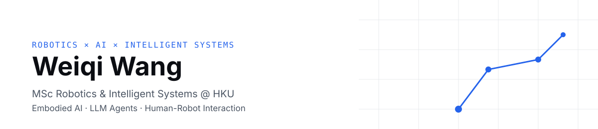

<!-- Profile README for github.com/wwqwhichone-ui. Keep claims factual; update when projects change. -->

  

<h2 align="center">Weiqi Wang | Robotics × AI × Intelligent Systems</h2>

  MSc Robotics &amp; Intelligent Systems @ HKU | Exploring Embodied AI, LLM Agents &amp; Intelligent Robotics

  <a href="https://wwqwhichone-ui.github.io"><b>Portfolio</b></a> ·
  <a href="https://github.com/wwqwhichone-ui?tab=repositories"><b>Repositories</b></a> ·
  <a href="#contact"><b>Contact</b></a>

---

### About me

I'm an MSc(Eng) student in **Robotics & Intelligent Systems** at **The University of Hong Kong**, with a B.Eng. in
**Engineering Mechanics** from **Northwestern Polytechnical University**. I'm interested in how large language models
can make robots easier to instruct — and how to keep that safe. My dissertation looks at generating actions for a mobile
industrial manipulator from voice commands.

I'm looking for roles as a **Robotics Engineer**, **AI / LLM Application Engineer** or **Embodied AI Engineer**.

### Research interests

- **Embodied intelligence** — grounding language in physical action
- **LLM-based robot task planning** — structured, verifiable plans instead of free-form output
- **Voice-controlled robotic manipulation**
- **Human-robot interaction**
- **Autonomous robotic systems**

### Featured projects

| Project | What it is | Status |
| --- | --- | --- |
| [**llm-robot-task-planner**](https://github.com/wwqwhichone-ui/llm-robot-task-planner) | Natural language → JSON-Schema-validated task plan → mock robot execution. Action whitelist, parameter limits, precondition checks, 24 unit tests. Runs offline; optional Claude backend. | Proof of concept |
| **voice-controlled-mobile-manipulator** | MSc dissertation: voice → language understanding → task planning → safe robot actions. | In progress (private) |
| [**robotics-learning**](https://github.com/wwqwhichone-ui/robotics-learning) | My notes and from-scratch exercises: kinematics, path planning, simulation. | Ongoing |
| [**ai-agent-experiments**](https://github.com/wwqwhichone-ui/ai-agent-experiments) | Log of small, real experiments with LLM agents and tool calling. | Starting |

### Currently working on

- 🎓 **Dissertation** — *Action Generation of Mobile Industrial Manipulator based on Voice Commands*
- 🧩 Extending the task planner toward a ROS 2 adapter and a plan-repair loop

### Tech stack

<!-- Only list tools actually used. Move items from "Learning" to "Using" when there is a project that shows them. -->

**Using:** Python · Git & GitHub · VS Code · pytest · JSON Schema · LLM APIs · AI coding agents · macOS

**Currently learning:** ROS 2 · robot simulation · LLM agent design

### Contact

<!-- Add only contact details you are happy to make public. -->
- Portfolio: <https://wwqwhichone-ui.github.io>
- LinkedIn: *to be added*

Last updated: November 2026
